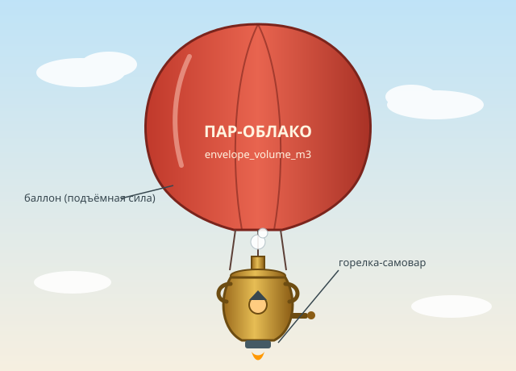

# ТЗ: Самовар-аэростат «Пар-Облако»

Автор: Сергеев Максим Витальевич

Стихия: воздух

Проект: «Пар-Облако»

Репозиторий: https://github.com/Kivi-9/flying_samovar

Дата заморозки: не назначена

Версия: 0.1

## 1. Назначение

«Пар-Облако» — самовар-аэростат: медный самовар, подвешенный под баллоном с горячим воздухом. Горелка самовара греет воздух в баллоне и одновременно кипятит воду для пилота-чаевода. Аппарат предназначен для перевозки пилота и небольшого груза над лесом, ущельями и перевалами. От обычного воздушного шара отличается тем, что подъёмная сила зависит от размера баллона, а баллон может быть разорван бурей.



## 2. Стихия и конструкционный элемент

**Стихия:** воздух.

**Конструкционный элемент:** баллон с нагретым воздухом, создающий подъёмную силу.

**Как реализован элемент:**

- Размер баллона задаёт атрибут `envelope_volume_m3`. Грузоподъёмность равна `lift_capacity_kg = envelope_volume_m3 * 0.5` кг. Взлёт возможен, только если `mass_kg + груз <= lift_capacity_kg`, иначе `SamovarOverweight`.
- Целостность баллона отражает атрибут `envelope_intact`. Пока баллон разорван (`envelope_intact == False`), аппарат не может ни взлететь, ни лететь дальше: `SamovarEnvelopeTorn`. Приземлиться разорванным можно.
- Баллон рвётся при вызове `damage_envelope()` и после успешного перелёта сквозь бурю (`weather="storm"`). Чинить баллон можно только на земле, за 15 единиц энергии.
- Размер баллона определяет, пролезет ли аппарат в ущелье: `can_overcome("gorge")` истинно только при `envelope_volume_m3 <= 500`.

**Ограничения стихии:**

- Основной режим — полёт; состояние «в воздухе» описывает `is_flying`.
- Аппарат взлетает и садится вертикально; высота и траектория не моделируются.
- Заправка и ремонт возможны только на земле.
- Движение по земле и по воде не моделируется.

## 3. Публичный интерфейс

Реализация должна соблюдать ровно описанный ниже контракт. Всё, чего здесь нет, — внутренняя реализация.

### 3.0. Общие правила контракта

1. **Числовые аргументы.** Допустимы `int` и `float`. `bool` числом **не считается**: `True`/`False` вместо числа — `TypeError`. `NaN`, `+inf` и `-inf` — `ValueError`. Любое другое значение нечислового типа (`str`, `None`, `list`, `bytes`) — `TypeError`.
2. **Строковые аргументы** (`weather`, `obstacle`) сравниваются точно: регистр и пробелы значимы, `"Calm"` и `" calm"` — неизвестные значения (`ValueError`). Не `str` — `TypeError`. Исключение — `name` конструктора, которое сохраняется без пробелов по краям.
3. **Порядок проверок во всех методах:** (1) типы всех аргументов, слева направо → `TypeError`; (2) значения всех аргументов, слева направо → `ValueError`; (3) состояние аппарата и ограничения — в порядке, указанном в описании метода → доменные исключения.
4. **Атомарность.** Если метод поднял исключение, состояние аппарата (`energy`, `position_km`, `is_flying`, `envelope_intact`, `load_kg`) не изменилось.
5. **Типы атрибутов.** Все числовые атрибуты хранятся как `float`, даже если переданы `int`. Возвращаемые вещественные значения сравниваются с допуском `1e-9`.
6. **Сообщения исключений** не входят в контракт и тестами не проверяются.
7. **Переполнение.** Если расчётная потребность в энергии при вычислении превышает максимально представимое `float` (получается `+inf`), она считается превышающей любой запас: `fly` поднимает `SamovarNoEnergy`, `calculate_energy` возвращает `float("inf")`.

**Константы:**

| Константа | Значение |
|---|---|
| Грузоподъёмность на 1 м³ баллона | 0.5 кг |
| Затраты энергии на взлёт | 10 ед. |
| Стоимость ремонта баллона | 15 ед. |
| Порог энергии для препятствия `"mountain"` | строго больше 30 ед. |
| Максимальный объём баллона для `"gorge"` | 500 м³ включительно |
| Максимум энергии | 100 ед. |

**Погода (параметр `weather`):**

| `weather` | Скорость | Расход энергии на 1 км |
|---|---|---|
| `"calm"` (штиль) | `max_speed_kmh` | 2 |
| `"tailwind"` (попутный ветер) | `max_speed_kmh * 1.5` | 1 |
| `"headwind"` (встречный ветер) | `max_speed_kmh * 0.5` | 3 |
| `"storm"` (буря) | `max_speed_kmh * 0.25` | 4 |

### 3.1. Класс

Имя класса: `FlyingSamovar`

Модуль: `flying_samovar.py`

Все доменные исключения (раздел 6) экспортируются из того же модуля.

### 3.2. Конструктор

```python
def __init__(
    self,
    name: str,
    mass_kg: float,
    envelope_volume_m3: float,
    max_speed_kmh: float,
    energy: float = 100.0,
) -> None:
```

| Параметр | Тип | Единица | Допустимое значение | По умолчанию |
|---|---|---|---|---|
| `name` | `str` | — | непустая строка после удаления пробельных символов по краям | — |
| `mass_kg` | `float` | кг | конечное, > 0 | — |
| `envelope_volume_m3` | `float` | м³ | конечное, > 0 | — |
| `max_speed_kmh` | `float` | км/ч | конечное, > 0 | — |
| `energy` | `float` | условные единицы | конечное, от 0 до 100 включительно | `100.0` |

Конструктор сохраняет имя без пробельных символов по краям (`name.strip()`) и задаёт начальное состояние: `position_km = 0.0`, `is_flying = False`, `envelope_intact = True`, `load_kg = 0.0`.

**Исключения конструктора:**

- `TypeError` — `name` не `str`; любой числовой параметр (включая `energy`) нечислового типа, `bool` или `None`.
- `ValueError` — `name` пуст или состоит из пробельных символов; `mass_kg`, `envelope_volume_m3` или `max_speed_kmh` ≤ 0 либо не конечны; `energy` вне 0…100 либо не конечна.

### 3.3. Атрибуты

Все публичные атрибуты доступны **только для чтения**: попытка присваивания вызывает `AttributeError`, значение не меняется.

| Атрибут | Тип | Единица | Описание |
|---|---|---|---|
| `name` | `str` | — | Имя аппарата (без пробелов по краям) |
| `mass_kg` | `float` | кг | Масса пустого аппарата |
| `envelope_volume_m3` | `float` | м³ | Объём баллона |
| `max_speed_kmh` | `float` | км/ч | Скорость при штиле |
| `energy` | `float` | условные единицы | Текущий запас энергии, 0…100 |
| `position_km` | `float` | км | Суммарное расстояние всех успешных вызовов `fly` |
| `is_flying` | `bool` | — | `True` после успешного `take_off` и до `land`; иначе `False` |
| `envelope_intact` | `bool` | — | `True`, пока баллон цел |
| `load_kg` | `float` | кг | Масса груза на борту: задаётся `take_off`, обнуляется `land` |
| `lift_capacity_kg` | `float` | кг | `envelope_volume_m3 * 0.5` |

### 3.4. Методы

#### 3.4.1. `take_off`

```python
def take_off(self, cargo_kg: float = 0.0) -> None:
```

**Назначение:** поднимает аппарат с грузом в воздух.

**Параметры:** `cargo_kg` — масса груза, кг, конечное число ≥ 0 (0 допустим).

**Возвращает:** `None`.

**Изменяет:** `is_flying = True`, `load_kg = float(cargo_kg)`, `energy` уменьшается на 10. `position_km` не меняется.

**Исключения (в порядке проверки):**

1. `TypeError` — `cargo_kg` нечислового типа или `bool`.
2. `ValueError` — `cargo_kg` < 0 или не конечно.
3. `SamovarNotOnGround` — аппарат уже в воздухе (`is_flying == True`).
4. `SamovarEnvelopeTorn` — `envelope_intact == False`.
5. `SamovarOverweight` — `mass_kg + cargo_kg > lift_capacity_kg` (равенство допустимо).
6. `SamovarNoEnergy` — `energy < 10` (при `energy == 10` взлёт допустим).

#### 3.4.2. `fly`

```python
def fly(self, distance_km: float, weather: str) -> float:
```

**Назначение:** перелёт на заданное расстояние при заданной погоде.

**Параметры:** `distance_km` — расстояние, км, конечное число > 0; `weather` — одно из `"calm"`, `"tailwind"`, `"headwind"`, `"storm"`.

**Возвращает:** время перелёта в часах (`float`) = `distance_km / скорость` (скорость и расход — по таблице погоды).

**Изменяет:** `position_km += distance_km`; `energy -= distance_km * расход_на_км`; при `weather == "storm"` после успешного перелёта `envelope_intact = False` (`is_flying` остаётся `True`). `load_kg` не меняется.

**Исключения (в порядке проверки):**

1. `TypeError` — `distance_km` нечислового типа или `bool`; `weather` не `str`.
2. `ValueError` — `distance_km` ≤ 0 или не конечно; `weather` вне списка.
3. `SamovarNotFlying` — аппарат на земле.
4. `SamovarEnvelopeTorn` — `envelope_intact == False`.
5. `SamovarNoEnergy` — требуемая энергия больше `energy` (если ровно равна, перелёт допустим и `energy` становится 0). Если перелёт сквозь бурю невозможен из-за энергии, баллон остаётся целым.

#### 3.4.3. `land`

```python
def land(self) -> None:
```

**Назначение:** посадка. Допустима и при разорванном баллоне.

**Изменяет:** `is_flying = False`, `load_kg = 0.0`. `energy`, `position_km` и `envelope_intact` не меняются.

**Исключения:** `SamovarNotFlying` — аппарат уже на земле.

#### Замечание: состояния «в воздухе» и «на земле»

Метод `take_off` переводит аппарат в воздух, `land` — на землю. Других способов изменить `is_flying` нет. Методы `refuel`, `repair_envelope` и `take_off` требуют состояния «на земле»; `fly` и `land` — «в воздухе».

#### 3.4.4. `can_overcome`

```python
def can_overcome(self, obstacle: str) -> bool:
```

**Назначение:** проверяет, может ли аппарат преодолеть препятствие. Не меняет состояние.

**Параметры:** `obstacle` — `"tree"`, `"mountain"` или `"gorge"`.

**Правила:**

- `"tree"` — `True`, только если `is_flying`.
- `"mountain"` — `True`, только если `is_flying` и `energy > 30` (строго).
- `"gorge"` — `True`, если `envelope_volume_m3 <= 500`; от состояния полёта не зависит.

Исправность баллона на результат не влияет.

**Исключения:** `TypeError` — `obstacle` не `str`; `ValueError` — значение вне списка.

#### 3.4.5. `calculate_energy`

```python
def calculate_energy(self, distance_km: float, weather: str) -> float:
```

**Назначение:** возвращает затраты энергии на перелёт (`distance_km * расход_на_км`) без изменения состояния. Проверки состояния не выполняются: метод работает на земле, при нулевой энергии и при разорванном баллоне.

**Исключения:** как пункты 1–2 у `fly` (`TypeError`, `ValueError`); `SamovarNoEnergy` и прочие доменные исключения не поднимаются.

#### 3.4.6. `refuel`

```python
def refuel(self, amount: float) -> None:
```

**Назначение:** пополняет энергию на земле.

**Параметры:** `amount` — конечное число > 0.

**Изменяет:** `energy = min(100.0, energy + amount)`.

**Исключения (в порядке проверки):** `TypeError` — `amount` нечислового типа или `bool`; `ValueError` — `amount` ≤ 0 или не конечно; `SamovarNotOnGround` — аппарат в воздухе.

#### 3.4.7. `damage_envelope`

```python
def damage_envelope(self) -> None:
```

**Назначение:** разрывает баллон (например, об острую скалу). Допустим на земле и в воздухе, идемпотентен.

**Изменяет:** `envelope_intact = False`. Исключений нет.

#### 3.4.8. `repair_envelope`

```python
def repair_envelope(self) -> None:
```

**Назначение:** чинит баллон на земле.

**Правила (в порядке проверки):**

1. Аппарат в воздухе → `SamovarNotOnGround` (даже если баллон цел).
2. Баллон цел → ничего не происходит, энергия не тратится.
3. `energy < 15` → `SamovarNoEnergy` (при `energy == 15` ремонт допустим).
4. Иначе `envelope_intact = True`, `energy -= 15`.

#### 3.4.9. `get_status`

```python
def get_status(self) -> dict:
```

**Возвращает:** новый словарь-снимок с **ровно** ключами `"name"` (`str`), `"energy"` (`float`), `"position_km"` (`float`), `"is_flying"` (`bool`), `"envelope_intact"` (`bool`), `"load_kg"` (`float`). Изменение словаря не влияет на аппарат и на другие снимки.

## 4. Сценарии

### 4.1. Модульные сценарии (AAA)

**Сценарий 1. Обычный перелёт.**
*Arrange:* `FlyingSamovar("Пар-Облако", 120, 400, 60, 100)`, вызван `take_off()` (энергия 90).
*Act:* `fly(30, "calm")`.
*Assert:* возвращено `0.5` (30 / 60); `position_km == 30`; `energy == 30` (90 − 30 × 2); `is_flying == True`.

**Сценарий 2. Не хватает энергии.**
*Arrange:* `FlyingSamovar("Пар-Облако", 120, 400, 60, 20)`, вызван `take_off()` (энергия 10).
*Act:* `fly(10, "calm")` (нужно 20).
*Assert:* `SamovarNoEnergy`; `position_km == 0`, `energy == 10`, `is_flying == True`.

**Сценарий 3. Перегруз.**
*Arrange:* `FlyingSamovar("Пар-Облако", 120, 400, 40, 100)` (грузоподъёмность 200).
*Act:* `take_off(81)` (120 + 81 > 200).
*Assert:* `SamovarOverweight`; `is_flying == False`, `energy == 100`, `load_kg == 0`.

**Сценарий 4. Заправка.**
*Arrange:* аппарат на земле, `energy = 20`.
*Act:* `refuel(50)`.
*Assert:* `energy == 70`.

### 4.2. Функциональные (сценарные) тесты (GWT)

Сценарные тесты выполняются через тестовую обёртку `Pilot` (см. `tests/test_flying_samovar.py`). Пилот управляет аппаратом на доменном языке: `взлететь`, `лететь`, `сесть`, `заправиться`, `чинить_баллон`, `проверить_препятствие` — каждая команда делегируется соответствующему методу. Если в сценарии сказано «поднимается ИСКЛЮЧЕНИЕ», вызов должен поднять именно его.

#### Сценарий 5. Чайный рейс над перевалом

**Given** «Пар-Облако» массой 120 кг, баллон 400 м³, скорость 40 км/ч, энергия 100
**And** аппарат на земле, баллон цел

**When** пилот берёт 60 кг груза и взлетает
**Then** аппарат в воздухе, `load_kg == 60`, `energy == 90`

**When** пилот летит 20 км при попутном ветре
**Then** время равно 20 / 60 ч
**And** `position_km == 20`, `energy == 70`

**When** пилот проверяет препятствия `mountain`, `tree`, `gorge`
**Then** результат `True` для каждого

**When** пилот летит 10 км при встречном ветре
**Then** время равно 0.5 ч
**And** `position_km == 30`, `energy == 40`
**And** `mountain` преодолима (`True`)

**When** пилот летит 5 км в штиль
**Then** время равно 0.125 ч
**And** `position_km == 35`, `energy == 30`
**And** `mountain` непреодолима (`False`, потому что энергия не больше 30)

**When** пилот садится и заправляется на 50
**Then** итоговое состояние: `is_flying == False`, `load_kg == 0`, `position_km == 35`, `energy == 80`, `envelope_intact == True`

#### Сценарий 6. Буря над ущельем

**Given** «Пар-Облако» массой 120 кг, баллон 400 м³, скорость 40 км/ч, энергия 100
**And** аппарат на земле

**When** пилот взлетает без груза и летит 10 км в штиль
**Then** время равно 0.25 ч, `position_km == 10`, `energy == 70`

**When** пилот летит 5 км сквозь бурю
**Then** время равно 0.5 ч (скорость 10 км/ч)
**And** `position_km == 15`, `energy == 50`
**And** `envelope_intact == False`, аппарат всё ещё в воздухе

**When** пилот пытается лететь ещё 1 км в штиль
**Then** поднимается `SamovarEnvelopeTorn`
**And** `position_km == 15`, `energy == 50`

**When** пилот совершает аварийную посадку
**Then** `is_flying == False`, `envelope_intact == False`

**When** пилот пытается снова взлететь
**Then** поднимается `SamovarEnvelopeTorn`
**And** `is_flying == False`, `energy == 50`

**When** пилот чинит баллон
**Then** `envelope_intact == True`, `energy == 35`

**When** пилот взлетает снова
**Then** итоговое состояние: `is_flying == True`, `energy == 25`, `position_km == 15`, `envelope_intact == True`, `load_kg == 0`

#### Сценарий 7. Перегруз и пустой бак

**Given** «Пар-Облако» массой 120 кг, баллон 400 м³, скорость 40 км/ч, энергия 12
**And** аппарат на земле

**When** пилот пытается взлететь с грузом 90 кг
**Then** поднимается `SamovarOverweight`
**And** `is_flying == False`, `energy == 12`, `load_kg == 0`

**When** пилот взлетает с грузом 80 кг (ровно предел)
**Then** `is_flying == True`, `load_kg == 80`, `energy == 2`

**When** пилот пытается лететь 2 км в штиль (нужно 4)
**Then** поднимается `SamovarNoEnergy`
**And** `position_km == 0`, `energy == 2`

**When** пилот летит 2 км при попутном ветре (нужно 2)
**Then** время равно 2 / 60 ч
**And** `position_km == 2`, `energy == 0`

**When** пилот пытается лететь ещё 1 км при попутном ветре
**Then** поднимается `SamovarNoEnergy`
**And** `position_km == 2`, `energy == 0`

**When** пилот садится
**Then** `is_flying == False`, `load_kg == 0`

**When** пилот пытается взлететь с пустым баком
**Then** поднимается `SamovarNoEnergy`
**And** `is_flying == False`, `energy == 0`

**When** пилот заправляется на 1000 и взлетает без груза
**Then** итоговое состояние: `is_flying == True`, `energy == 90` (заправка ограничена 100, взлёт стоит 10), `position_km == 2`, `load_kg == 0`

#### Сценарий 8. Облачный Лайнер: большой баллон

**Given** «Облачный Лайнер» массой 300 кг, баллон 800 м³ (грузоподъёмность 400 кг), скорость 30 км/ч, энергия 60
**And** аппарат на земле

**When** пилот проверяет препятствия `gorge`, `tree`, `mountain` на земле
**Then** результат `False` для каждого (`gorge` — баллон больше 500 м³; остальные — аппарат не в воздухе)

**When** пилот взлетает с грузом 100 кг (300 + 100 == 400, ровно предел)
**Then** `is_flying == True`, `load_kg == 100`, `energy == 50`
**And** `tree` — `True`, `mountain` — `True`, `gorge` — `False`

**When** пилот летит 10 км при встречном ветре
**Then** время равно 10 / 15 ч (скорость 15 км/ч)
**And** `position_km == 10`, `energy == 20`
**And** `mountain` — `False`

**When** пилот летит 7 км в штиль
**Then** время равно 7 / 30 ч
**And** `position_km == 17`, `energy == 6`

**When** пилот пытается лететь ещё 4 км в штиль (нужно 8)
**Then** поднимается `SamovarNoEnergy`
**And** итоговое состояние: `position_km == 17`, `energy == 6`, `is_flying == True`, `load_kg == 100`, `envelope_intact == True`

### 4.3. Test Case Specification

Полная таблица тест-кейсов с ID, типом, источником в SPEC, предусловием, входом, ожиданием и приоритетом приведена в [TEST_CASES.md](TEST_CASES.md). В ней 19 модульных и 4 сценарных кейса (около 83 % / 17 %).

## 5. Граничные случаи

Каждый случай проверяется тестом.

- `fly(0, "calm")` → `ValueError`; позиция и энергия не меняются (TC-11).
- `take_off(80)` при `mass_kg=120`, `envelope_volume_m3=400` → успех (120 + 80 == 200); `take_off(80.1)` → `SamovarOverweight` (TC-05, TC-06).
- `take_off()` при `energy == 10` → успех, `energy == 0`; при `energy == 9.9` → `SamovarNoEnergy` (TC-05, TC-06).
- `fly` на расстояние, на которое энергии хватает ровно → `energy == 0`; следующий `fly(0.1, "tailwind")` → `SamovarNoEnergy` (TC-10).
- `refuel(1000)` при `energy == 50` → `energy == 100`, не больше (TC-16).
- `can_overcome("mountain")` при `energy == 30` → `False`, при `30.5` → `True` (TC-13).
- `can_overcome("gorge")` при `envelope_volume_m3 == 500` → `True`, при `500.5` → `False` (TC-14).
- `repair_envelope()` при `energy == 15` → `energy == 0`; при `14.5` → `SamovarNoEnergy` (TC-17).
- `land()` при разорванном баллоне допустима; `take_off()` при разорванном — `SamovarEnvelopeTorn` (TC-12, TC-06).

## 6. Исключения

### 6.1. Иерархия

```
CrazyVehicleError(Exception)
└── SamovarError
    ├── SamovarNoEnergy
    ├── SamovarEnvelopeTorn
    ├── SamovarOverweight
    ├── SamovarNotFlying
    └── SamovarNotOnGround
```

Доменные исключения **не** наследуются от `ValueError`, `TypeError` и `RuntimeError`.

### 6.2. Таблица

| Ситуация | Исключение | Пример |
|---|---|---|
| Неверный тип аргумента (в т. ч. `bool` вместо числа, `None`) | `TypeError` | `fly("abc", "calm")`, `take_off(True)` |
| Недопустимое значение: пустое имя, неположительные параметры, `NaN`/`inf`, неизвестная погода или препятствие | `ValueError` | `fly(0, "calm")`, `fly(5, "Calm")` |
| Не хватает энергии на взлёт, перелёт или ремонт | `SamovarNoEnergy` | `fly(100, "calm")` при `energy == 5` |
| Баллон разорван (взлёт, перелёт) | `SamovarEnvelopeTorn` | `fly(1, "calm")` после бури |
| Груз и масса превышают грузоподъёмность | `SamovarOverweight` | `take_off(81)` при грузоподъёмности 200 и массе 120 |
| Действие, требующее полёта, на земле (`fly`, `land`) | `SamovarNotFlying` | `land()` на земле |
| Действие, требующее земли, в воздухе (`take_off`, `refuel`, `repair_envelope`) | `SamovarNotOnGround` | `refuel(10)` в воздухе |

Приоритет проверок описан в разделе 3.0 (общие правила) и в разделе «Исключения» каждого метода.

## 7. Что вне рамок

- Высота полёта, вертикальные манёвры, траектория, повороты и координаты.
- Физика нагрева воздуха, расчёт плотности и реальной подъёмной силы.
- Моделирование воды в самоваре, чаепития и пилота как отдельного объекта.
- Взаимодействие с другими аппаратами.
- Графика и визуализация (картинка в разделе 1 носит иллюстративный характер).
- Сохранение состояния между запусками, работа с файлами, сетью и API.
- Время заправки, ремонта и посадки.

## 8. Трассируемость «требование → тест»

| Требование | Раздел ТЗ | TC / тест |
|---|---|---|
| Конструктор принимает корректные параметры; атрибуты — `float`; начальное состояние; `energy=100.0` по умолчанию; обрезка имени | 3.2, 3.3 | TC-01 `test_TC_01_constructor_valid_and_initial_state` |
| Недопустимые значения конструктора → `ValueError`; граничные 0 и 100 для энергии допустимы | 3.2 | TC-02 `test_TC_02_constructor_invalid_values` |
| Неверные типы (в т. ч. `bool`, `None`) в конструкторе → `TypeError` | 3.0, 3.2 | TC-03 `test_TC_03_constructor_wrong_types` |
| Публичные атрибуты только для чтения | 3.3 | TC-04 `test_TC_04_public_attributes_are_read_only` |
| Взлёт: состояние, груз, расход 10, значение по умолчанию, границы по массе и энергии | 3.4.1, 5 | TC-05 `test_TC_05_take_off_success_and_boundaries` |
| Ошибки взлёта (`Overweight`, `NoEnergy`, `EnvelopeTorn`, `NotOnGround`, `ValueError`, `TypeError`), состояние не меняется | 3.4.1, 6 | TC-06 `test_TC_06_take_off_errors_keep_state` |
| Порядок проверок взлёта | 3.0, 3.4.1 | TC-07 `test_TC_07_take_off_check_priority` |
| Время, расход и позиция при штиле, попутном и встречном ветре; накопление позиции | 3.4.2 | TC-08 `test_TC_08_fly_calm_tailwind_headwind` |
| Буря: скорость, расход, разрыв баллона после перелёта | 3.4.2, 2 | TC-09 `test_TC_09_fly_storm_tears_envelope` |
| `fly` на земле и с разорванным баллоном; граница энергии; переполнение | 3.4.2, 3.0 п.7, 5 | TC-10 `test_TC_10_fly_state_errors_and_energy_boundary` |
| Некорректные аргументы `fly` и порядок проверок | 3.0, 3.4.2 | TC-11 `test_TC_11_fly_invalid_arguments_and_priority` |
| Посадка: сброс груза и полёта; посадка разорванным; ошибка на земле | 3.4.3 | TC-12 `test_TC_12_land` |
| `can_overcome("tree")` и `("mountain")`, граница 30, независимость от баллона | 3.4.4, 5 | TC-13 `test_TC_13_can_overcome_tree_and_mountain` |
| `can_overcome("gorge")`, граница 500, ошибки аргумента, отсутствие побочных эффектов | 3.4.4, 5 | TC-14 `test_TC_14_can_overcome_gorge_invalid_and_pure` |
| `calculate_energy`: значения, отсутствие побочных эффектов и проверок состояния, ошибки, переполнение | 3.4.5, 3.0 п.7 | TC-15 `test_TC_15_calculate_energy` |
| `refuel`: прирост, потолок 100, ошибки аргументов и состояния | 3.4.6, 5 | TC-16 `test_TC_16_refuel` |
| `damage_envelope` и `repair_envelope`: стоимость 15, границы, ограничения полёта | 3.4.7, 3.4.8, 5 | TC-17 `test_TC_17_damage_and_repair_envelope` |
| `get_status`: ровно заданные ключи, актуальные значения, независимый снимок | 3.4.9 | TC-18 `test_TC_18_get_status` |
| Иерархия доменных исключений | 6.1 | TC-19 `test_TC_19_domain_exception_hierarchy` |
| Сценарий 5 «Чайный рейс над перевалом» | 4.2 | TC-20 `test_TC_20_tea_flight_over_the_pass` |
| Сценарий 6 «Буря над ущельем» | 4.2 | TC-21 `test_TC_21_storm_over_the_gorge` |
| Сценарий 7 «Перегруз и пустой бак» | 4.2 | TC-22 `test_TC_22_overweight_and_empty_tank` |
| Сценарий 8 «Облачный Лайнер: большой баллон» | 4.2 | TC-23 `test_TC_23_big_envelope_liner` |
| Сценарий 1 (обычный перелёт) из 4.1 | 4.1 | TC-08 (подслучай «скорость 60») |
| Сценарий 2 (не хватает энергии) из 4.1 | 4.1 | TC-10 (подслучай «energy == 10») |
| Сценарий 3 (перегруз) из 4.1 | 4.1 | TC-06 (подслучай `take_off(81)`) |
| Сценарий 4 (заправка) из 4.1 | 4.1 | TC-16 (подслучай (a)) |

## 9. Открытые вопросы

1. Должна ли посадка (`land`) расходовать энергию? Сейчас она бесплатна.
2. Должна ли буря рвать баллон, если энергии на весь перелёт не хватило? Сейчас в этом случае поднимается `SamovarNoEnergy` и ничего не меняется.
3. Нужна ли в модели высота (вертикальные манёвры, потолок для `"mountain"`)? Сейчас вне рамок (раздел 7).
